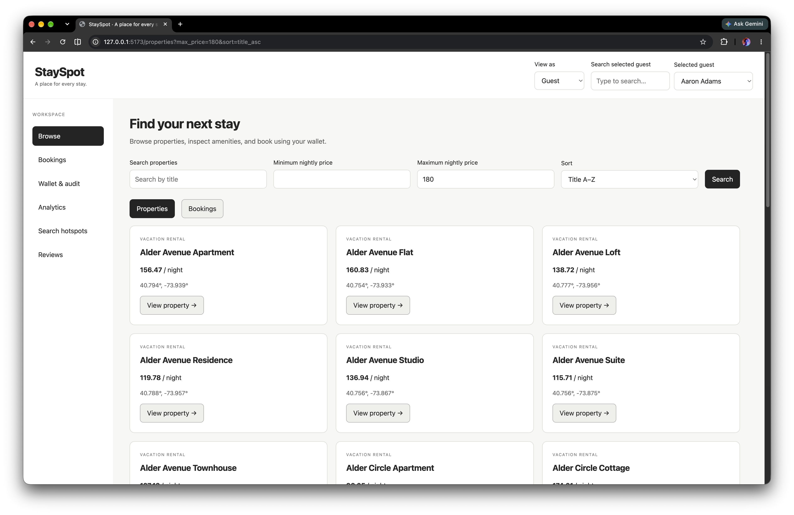

# StaySpot — Assignment 2

CS6.302 Software System Development · Group 12 · P3: Vacation Rental & Experiences

StaySpot is a web application built on the inherited Assignment 1 PostgreSQL and MongoDB backend. Guests can browse properties, book stays using their wallet, and review completed stays. Staff can browse guests and inspect bookings, wallet history, property performance, search hotspots, and review analytics.

- **Repository:** (Add later)
- **Final Submission commit hash:** (Add later)
- **Demo video:** (Add later)


## Features


| Screen              | Functionality                                                                                                  |
| ------------------- | -------------------------------------------------------------------------------------------------------------- |
| Browse              | Guests, properties, and bookings with search/filters, pagination, and details                                  |
| Book stay           | Stored-procedure booking, wallet balances before/after, friendly failures, and the trigger-created audit entry |
| Wallet & audit      | Read-only history with date filters and balance after each transaction                                         |
| Analytics           | Per-property seven-day moving average, dense rankings, and materialized-view totals with refresh time/button   |
| Search hotspots     | Map using `$geoNear`, selectable origin, 5 km radius, distance-sorted results, and ten-second polling          |
| Reviews & amenities | `$facet` rating distribution, top tags, average rating, and readable `PropertyAmenities` documents             |


The UI includes actor switching, loading/empty/error states, and responsive layouts. Bookings move through `CONFIRMED → CHECKED_IN → COMPLETED`; a guest cannot have two checked-in stays. Completed bookings also support one guest-written review.

## Technology choices

- **React, Vite, React Router, and plain CSS:** a small frontend with reusable controls and simple navigation.
- **Express with** `pg` **and the MongoDB driver:** a thin API that leaves transactions, triggers, window calculations, and aggregations in the databases.
- **Leaflet/OpenStreetMap and SVG charts:** maps and lightweight charts with a table alternative for revenue values.
- **PostgreSQL:** guests, properties, bookings, wallet audit, and revenue summaries. **MongoDB:** amenities, reviews, and search sessions.


## Run locally

Install Node.js **22.12+**, npm, Python 3, PostgreSQL (including `psql` and `createdb`), MongoDB, and `mongosh`. Start both database services. Run the following commands from the repository root unless stated otherwise.

### 1. Set up a fresh database

These commands assume local PostgreSQL on port 5432 with your OS username and no password, and MongoDB on port 27017. Use an empty `stayspot` database; seeders refuse to append to populated data.

```bash
createdb stayspot
psql -v ON_ERROR_STOP=1 -d stayspot -f sql/01_schema_ddl.sql
psql -v ON_ERROR_STOP=1 -d stayspot -f sql/02_indexes.sql
psql -v ON_ERROR_STOP=1 -d stayspot -f sql/03_triggers_and_audit.sql
psql -v ON_ERROR_STOP=1 -d stayspot -f sql/04_stored_procedures.sql
psql -v ON_ERROR_STOP=1 -d stayspot -f sql/05_materialized_views.sql
psql -v ON_ERROR_STOP=1 -d stayspot -f sql/07_api_support.sql
mongosh "mongodb://127.0.0.1:27017/stayspot" mongo/01_collections_and_indexes.js

python3 -m venv .venv
source .venv/bin/activate
pip install -r data_generation/requirements.txt
python data_generation/postgres_seeder.py
python data_generation/mongo_seeder.py
```

Seed PostgreSQL first so MongoDB records reference existing guests and properties. The seeders create 10,000 guests, 5,000 properties, 100,000 bookings, over 100,000 audit entries, 1,000 amenities documents, 30,000 reviews, and 550,000 search sessions.

For custom connections, use the `STAYSPOT_PG_*` and `STAYSPOT_MONGO_*` variables listed in [api/.env.example](api/.env.example). Export these for the Python seeders; they do not load `api/.env`. Configure `psql`/`createdb` separately through their connection flags or standard `PG*` variables, and pass your MongoDB URI to `mongosh`.

### 2. Start the API

```bash
cd api
npm ci
# Optional for custom connections:
# cp .env.example .env
# Edit .env, especially STAYSPOT_PG_USER and the password.
npm run migrate
npm start
```

Without `.env`, the API uses the local defaults described above. If the database is already seeded, skip step 1, run the migration, and reapply `mongo/01_collections_and_indexes.js` using `mongosh` to update validators and the review index. Do not rerun the seeders.

### 3. Start the frontend in another terminal

```bash
cd web
npm ci
npm run dev
```

Open **[http://127.0.0.1:5173](http://127.0.0.1:5173)**. Keep both terminals running. The API listens on **127.0.0.1:3001**, and Vite proxies `/api` requests to it. If changing the API port, update `web/vite.config.js` too.

Choose a guest in the header to book a stay. Switch to **Staff** to see the Guests screen. On Analytics, click **Refresh summary** after seeding. Search pins expire after two hours; use **Add search pin** if the map is empty. Map tiles require internet access.

## Tests

With both databases running and initialized:

```bash
npm --prefix api test
npm --prefix web test
npm --prefix web run build
```

On 13 October 2026, all **14 API tests**, **3 frontend tests**, and the production build passed. Tests cover booking/audit correctness, insufficient funds, concurrent debits, status conflicts, browsing, analytics, map pins, reviews, and request recovery. API tests remove their fixtures and refresh the summary and its timestamp. A fresh complete laptop/phone browser walkthrough remains to be done.

## Changes to the inherited backend

- Fixed MongoDB validator reapplication by replacing the unsupported `assert.commandWorked` helper.
- Updated the audit trigger to expose its new entry ID and the booking procedure to return the booking ID while preserving existing five-argument calls.
- Added `sql/07_api_support.sql` for persistent refresh metadata and a guest-booking index.
- Added optional review booking IDs and a unique partial index to prevent duplicate reviews for a booking.
- Updated the PostgreSQL seeder to produce unique, reproducible fictional property names without changing record counts.

See [the handover note](docs/handover_note.md) for inherited behavior, fixes, and suggestions.

## Assumptions and limitations

- Guest/Staff selection is a demo mode, not authentication. Real login is not required by the assignment.
- Check-in must be today or later in Asia/Kolkata; check-out must be later. The API owns transaction commit/rollback and calculates the price.
- The active-stay index prevents two `CHECKED_IN` bookings for one guest; it does not prevent overlapping future reservations.
- The seven-day moving average excludes days without bookings. Rankings and summary totals cover all history. Refresh time is unknown until refreshed through the API.
- Amounts are currency units because the inherited schema has no currency field. Audit rows show the stored balance after each change; database-level audit immutability is not enforced.
- Property editing, refunds, and wallet top-ups are outside the implemented scope. Each completed booking permits one review by its selected guest.


## Design, screenshots, and project files

- [Users, flows, and visual system](docs/design/README.md) · [Figma wireframes](https://www.figma.com/design/gTOkIC3vtMfNP2le4hF9ed) · [Updated wireframe exports](docs/design/wireframes/)
- The 15 updated wireframes cover desktop screens, mobile layouts, loading/error states, and visual foundations. Screenshots of the running application are saved in [docs/screenshots/](docs/screenshots/).
- [API endpoints](docs/api_endpoints.md) · [Relational ERD](docs/relational_erd.png) · [MongoDB schema](docs/mongo_schema_map.json)
- `web/`: frontend · `api/`: server · `sql/` and `mongo/`: database scripts · `data_generation/`: seeders · `performance/`: inherited query evidence


### Application screenshots


| Screen              | Screenshots                                                                                                      |
| ------------------- | ---------------------------------------------------------------------------------------------------------------- |
| Browse properties   | [Property browsing](docs/screenshots/browse-property.png)                                                        |
| Bookings            | [Bookings](docs/screenshots/bookings.png)                                                                        |
| Guests              | [Guest list](docs/screenshots/guest-list.png) · [Guest detail](docs/screenshots/guest-detail.png)                |
| Wallet & audit      | [Wallet history](docs/screenshots/wallet-and-audit.png)                                                          |
| Analytics           | [Analytics](docs/screenshots/analytics1.png) · [Property performance](docs/screenshots/property-performance.png) |
| Search hotspots     | [Map and search results](docs/screenshots/search-hotspots.png)                                                   |
| Reviews & amenities | [Reviews](docs/screenshots/reviews.png)                                                                          |




## Team contributions

Suggested contribution split; confirm it matches each member's actual work before submission.


| Member         | Design contribution                                              | Code / testing contribution                                                                  |
| -------------- | ---------------------------------------------------------------- | -------------------------------------------------------------------------------------------- |
| Jenil Padshala | Booking flow, confirmation screen, and wallet feedback           | Booking API and stored-procedure integration; transaction, balance, and audit tests          |
| Nehal Gupta    | Property and guest browsing, detail views, and reusable controls | Browse screens, search/filter, pagination, and actor switching; loading/empty/error checks   |
| Muppidi Reddy  | Revenue dashboard, wallet history, and chart layouts             | Moving averages, rankings, summary refresh, and audit views; analytics and date-filter tests |
| Aditi Nigam    | Search map, reviews, amenities, and mobile layouts               | Hotspot polling, review facets, and amenities display; map, review, and responsive UI checks |
